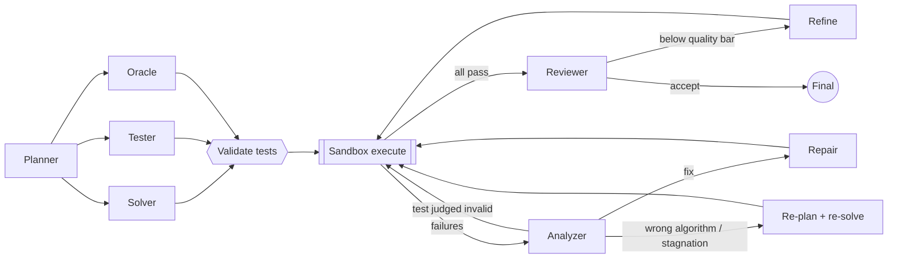

# PromptForge AI

**An autonomous multi-agent platform that turns a programming problem into working, tested code.**

A team of LLM agents plans an algorithm, writes the solution, writes adversarial tests, and checks those
tests against a brute-force oracle. It then runs everything in a sandbox, diagnoses failures and repairs the code
until it passes. A telemetry-driven routing engine decides which LLM handles each step, and it learns from latency,
failures, output quality and downstream results.

Built with Python, LangGraph, FastAPI and Next.js. Runs fully offline in mock mode, so no API key is needed to try it.

---

## What it does

| Capability | Where |
|---|---|
| **Multi-agent orchestration (LangGraph).** Seven specialised agents in a stateful graph with a parallel fan-out and three feedback loops: repair, re-plan and quality refinement. | `backend/app/pipeline/` |
| **LLM routing engine.** Ranks every model for every call using task-weighted capability, Bayesian-smoothed reliability, EWMA latency, schema-validity and downstream reward, plus UCB exploration and a circuit breaker. Every decision is explainable. | `backend/app/llm/router.py`, `telemetry.py` |
| **Autonomous testing & repair.** AI-written tests are cross-validated by a brute-force oracle calibrated on the problem's own examples. Code is compiled and run in a resource-limited sandbox, failures are diagnosed, and the code is repaired with a regression guard. | `backend/app/execution/`, `pipeline/nodes.py` |
| **Live dashboard.** Streams each agent step over SSE and shows a verdict matrix (versions × tests), test provenance, per-call routing rankings, model telemetry and run history. | `frontend/` |

## Architecture



Every agent call goes through `LLMService`:

```
route(task) ─► ranked fallback chain ─► provider call (timeout) ─► telemetry
     ▲                                                            │
     └──── success rate · latency · JSON validity · reward ◄──────┘
```

### The agents

| Agent | Task type | Output |
|---|---|---|
| Planner | `planning` | Algorithm, complexity, I/O format, edge cases, **ground-truth samples extracted from the statement** |
| Solver | `coding` | Full solution (C++17 or Python 3) |
| Tester | `testing` | 8–12 adversarial hidden tests |
| Oracle | `oracle` | Deliberately naive brute-force reference solution |
| Analyzer | `analysis` | Root cause, fix strategy, `needs_replan`, tests it believes are wrong |
| Repair | `repair` | Fixed code (always starts from the best version so far) |
| Reviewer | `review` | Efficiency, edge-case, quality and readability scores once the tests pass |

### LLM routing engine

For each call the router scores every eligible model:

```
score = 0.40·capability   task-weighted priors (coding / reasoning / json / speed / quality)
      + 0.25·reliability  Beta-smoothed success rate, global and per task
      + 0.15·latency      budget / (budget + EWMA latency)
      + 0.20·quality      schema-valid output rate + downstream reward per task
      + reasoning bonus   reasoning models for planning / analysis / repair
      − json penalty      models without JSON mode on structured tasks
      + exploration       UCB1 bonus for models rarely tried on this task
```

* **Circuit breaker:** after 3 consecutive failures a model cools down (60 s, doubling up to 16×). Rate limits
  always trigger a short cooldown. If every model is cooling down, the router degrades gracefully instead of failing.
* **Fallback chain:** the top-k ranked models are tried in order. Timeouts, 429s, empty responses and errors are
  each recorded by kind.
* **Outcome feedback:** the pipeline sends rewards back to the router. Solver and repair models are rewarded
  by the pass rate of their code, the analyzer by whether its diagnosis led to an improvement, the tester by how
  many of its expected outputs the oracle confirmed, the oracle by its calibration, and the planner by the best
  result its plan produced.
* **Explainability:** every trace entry carries the ranking and per-component breakdown, shown in the
  *Model routing* tab.
* `ROUTING_STRATEGY=static` switches to capability-only routing as an A/B baseline.

Models are discovered automatically: free text models from OpenRouter (cached in `backend/data/models_cache.json`) and
the configured Groq models.

### Testing & repair pipeline

1. **Ground truth.** The planner copies the examples from the problem statement. These are never altered.
2. **Differential validation.** The oracle must pass every ground-truth sample to be *trusted*. A trusted oracle
   marks generated tests as `verified`, or `corrected` when it overrides a wrong expected output. Without a trusted
   oracle, tests stay `unverified` and are flagged.
3. **Sandbox.** `g++ -O2` or CPython, run per test with a wall-clock timeout, CPU/memory/file-size/process rlimits,
   output truncation and process-group kill. Verdicts: AC / WA / TLE / RE / CE. Comparison is token-wise with
   float tolerance.
4. **Analysis.** The analyzer classifies the failure (compile, runtime, timeout, wrong answer, edge case, wrong
   algorithm, I/O format, invalid test). If it is confident an *unverified* test is wrong, that test is dropped and
   the code is re-run.
5. **Repair loop.** Targeted repairs start from the best version so far, so a regression is never kept. Two repairs
   in a row with no improvement, or a wrong-algorithm diagnosis, trigger a re-plan with a different approach.
6. **Quality gate.** Once every test passes, the reviewer scores the code. Below the acceptance bar, one refinement
   pass runs, and it is discarded if it breaks any test.

## Quick start

### Backend

```bash
cd backend
python -m venv .venv && source .venv/bin/activate      # Windows: .venv\Scripts\activate
pip install -r requirements-dev.txt
cp .env.example .env            # add OPENROUTER_API_KEY and/or GROQ_API_KEY, or leave empty for mock mode
uvicorn app.main:app --reload   # http://localhost:8000/docs
```

`g++` must be on the PATH for C++ problems (on Windows use MSYS2/MinGW, or run with Docker).

### Frontend

```bash
cd frontend
npm install
npm run dev                     # http://localhost:3000
```

### Docker

```bash
docker compose up --build       # backend :8000, dashboard :3000
```

The backend container runs with a read-only filesystem, `no-new-privileges` and pid/memory limits, because it
executes generated code.

### CLI

```bash
cd backend
python -m app.cli problems/max_subarray.txt --language python --out solution.py
```

### Offline mock mode

With no API key (or `MOCK_MODE=true`) the router chooses among four simulated models with different personalities:
a strong but flaky model that fails 2 of 3 calls, a fast model that returns broken JSON, and two dependable ones. The
agents are scripted for the maximum-subarray demo problem. The first solution has a deliberate bug and one generated
test has a wrong expected output, so a single run exercises fallback, oracle correction, failure analysis and
repair. Real problems need a live API key.

## API

| Method | Path | Purpose |
|---|---|---|
| `POST` | `/api/solve` | Run the pipeline, return the final result |
| `POST` | `/api/solve/stream` | Same, as Server-Sent Events (`start` → `node`… → `result`) |
| `POST` | `/api/execute` | Run any code against tests in the sandbox |
| `GET` | `/api/models?task=coding` | Model catalog with the router's live ranking and breakdown |
| `GET` | `/api/routing/preview` | Which model would be chosen for every task right now |
| `GET` / `DELETE` | `/api/telemetry` | Per-model, per-task telemetry / reset it |
| `POST` | `/api/models/refresh` | Re-discover OpenRouter models |
| `GET` | `/api/runs`, `/api/runs/{id}` | Run history |
| `GET` | `/api/health` | Mode, model count, providers |

Request body for `/api/solve`:

```json
{ "problem": "…", "language": "cpp", "acceptance_score": 85, "max_repairs": 4, "max_replans": 1, "max_refinements": 1 }
```

## Project layout

```
backend/
  app/
    agents/       base agent (JSON retry + quality feedback) and the seven agents
    llm/          catalog, providers (OpenRouter, Groq, mock), router, telemetry, service
    execution/    sandbox, output judge, oracle-based test validation
    pipeline/     LangGraph state, nodes, conditional routing, graph wiring
    prompts/      system prompts
    schemas/      Pydantic contracts (Plan, TestCase, ExecutionReport, FailureAnalysis, Review)
    services/     run orchestration, streaming, history
    api/          FastAPI routes
    cli.py        command-line runner
  tests/          55 offline tests (pytest)
  problems/       sample problem statements
frontend/         Next.js 16 dashboard
docs/ARCHITECTURE.md
```

## Tests

```bash
cd backend && pytest -q
```

The suite runs fully offline in about 30 seconds. It covers JSON/code extraction, output judging, sandbox verdicts
(AC/WA/TLE/RE/CE in both languages), oracle validation, telemetry persistence and the circuit breaker, router
behaviour (task fit, demotion, reward, exploration, static baseline), provider fallback and timeouts, structured-output
retries, the full graph in C++ and Python, invalid-test pruning, the re-plan loop, SSE streaming and every API endpoint.

## Configuration

All settings are environment variables (see `backend/.env.example`): routing strategy, fallback depth, exploration
weight, breaker threshold and cooldown, LLM timeout, repair/re-plan/refinement budgets, acceptance score, and sandbox
time and memory limits.
